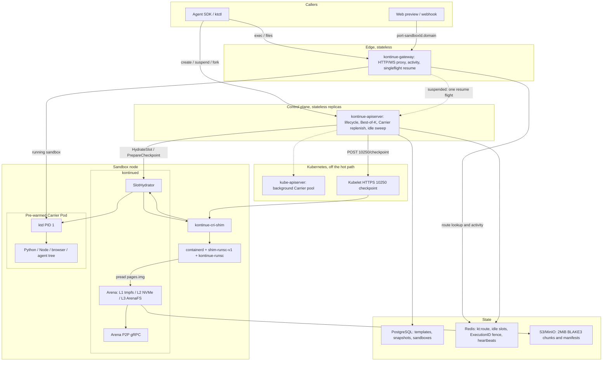
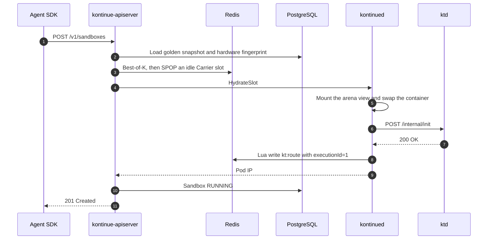
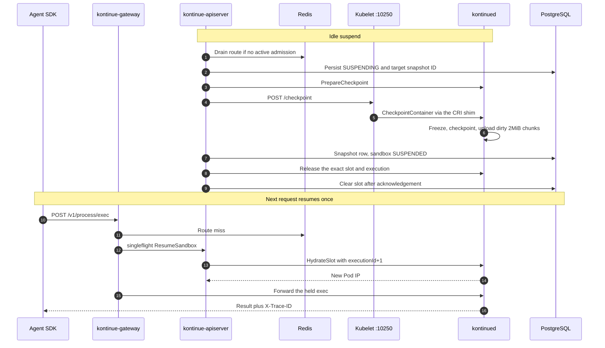
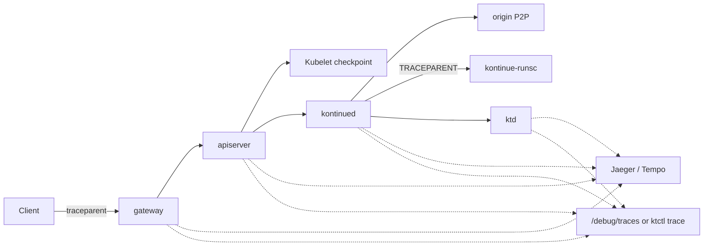
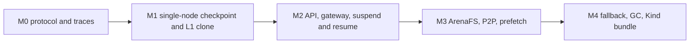

# Kontinue architecture, component duties, and MVP plan

> **Name:** Kontinue (Kubernetes + Continue). Freeze a guest and resume its process tree from the captured memory image.
> **Role:** A high-throughput memory snapshot and resume platform for agent workloads: coding sandboxes, browser use, RL rollouts, and interactive analysis.
> **Stack:** PostgreSQL and Redis for the control plane, a pre-warmed Carrier Pod pool, the Kubernetes Kubelet checkpoint API, gVisor (`runsc`) with a three-tier memory arena (tmpfs, NVMe CAS, ArenaFS FUSE plus P2P), and OpenTelemetry traces.
> **Related docs:** The task ledger is [PLAN.md](./PLAN.md). Language rules are [DEVELOPMENT_STANDARDS.md](./DEVELOPMENT_STANDARDS.md). The 1-to-N clone path is [TEMPLATE_TO_SANDBOX.md](./TEMPLATE_TO_SANDBOX.md). GPU `cuda-checkpoint` stays deferred. Through M4 the product is a CPU and memory sandbox.

---

## 1. Components

Six runtime processes and one diagnostic CLI. Each has one job.

| Name | Binary | Deployed as | Role |
| :--- | :--- | :--- | :--- |
| **Kontinue API Server** | `kontinue-apiserver` | Stateless Deployment | Templates, sandbox start/stop/fork, Best-of-K placement, Kubelet `/checkpoint`, and background Carrier replenishment |
| **Kontinue Gateway** | `kontinue-gateway` | Stateless Deployment | Edge proxy for host-based routing and the SDK. Tracks active connections and singleflight-resumes a suspended sandbox. |
| **Kontinue Node Daemon** | `kontinued` | One DaemonSet pod per sandbox node | Slot swap, the three-tier arena, and cross-node P2P |
| **Kontinue CRI Shim** | `kontinue-cri-shim` | Host systemd daemon | Thin CRI proxy between Kubelet and `containerd.sock`. Survives a `kontinued` restart and intercepts checkpoint calls. |
| **Kontinue gVisor Wrapper** | `kontinue-runsc` | Host binary, `RuntimeClass: kontinue-gvisor` | OCI wrapper. Injects overlay, network, and background-restore flags, and reports when `wait --restore` returns. |
| **Kontinue Guest Agent** | `ktd` | PID 1 inside the sandbox, port 49983 | Freeze, held init, exec, PTY, and files. The in-guest counterpart of E2B `envd`. |
| **Kontinue CLI** | `ktctl` | Operator binary | Templates, sandbox debug, and `ktctl trace <sandbox-id>` |

---

## 2. Why this shape

E2B bakes a live environment into memory and resumes it in about a hundred milliseconds. Doing that on Kubernetes hits four constraints.

1. **etcd is too slow for the hot path.** A CRD operator writes etcd 6–10 times for one suspend and resume, then waits on watch, reconcile, the scheduler, Kubelet PLEG, and CNI. That is 1–3 seconds, and the API server throttles around 100–200 QPS. Kontinue keeps sandbox state in PostgreSQL and Redis. Kubernetes only maintains the Carrier Pod pool in the background. A warm create or resume does not write etcd, does not wait for the scheduler, and does not add a network.
2. **Kubelet checkpoint has no restore, and CRI checkpoint is unimplemented for this runtime.** Kubernetes v1.30+ exposes `POST https://<node>:10250/checkpoint/{namespace}/{pod}/{container}`, but it only exports a local tar and has no restore API. containerd's CRI `CheckpointContainer` returns `Unimplemented` for the sandbox runtime. Kubelet also only checkpoints a Pod it already knows. Each sandbox therefore lives inside a real pre-warmed Carrier Pod. `kontinue-cri-shim` forwards `CheckpointContainer` to `kontinued`, which exports a split gVisor snapshot. Restore mounts a local or on-demand memory view and calls `runsc restore`. There is no image pull and no full tar extract.
3. **Demand paging and incremental storage.** gVisor checkpoints are uncompressed and split: a few megabytes of `checkpoint.img`, a page index `pages_meta.img`, and the raw `pages.img`. `runsc restore --background=true` runs as soon as `checkpoint.img` is loaded and `pread`s missing pages later. L1 tmpfs, L2 2MiB BLAKE3 chunks, and L3 ArenaFS (FUSE plus P2P) make restore cheap and dedup about 85–95% of stored pages.
4. **Isolation and a clean identity on clone.** gVisor is the user-space kernel boundary. `ktd` is PID 1. On restore, a held `POST /internal/init` rotates tokens, injects tenant secrets that were never in the template image, reseeds the PRNG, and resets `machine-id`, hostname, and the clock offset.

---

## 3. Topology

Four layers: edge, control plane, node data plane, and storage.



---

## 4. What each component owns

### 4.1 `kontinue-apiserver`

Owns the lifecycle API: bake a template, clone a sandbox (1-to-N), suspend, resume, fork (1-to-K), and delete. Requests can carry `Idempotency-Key`. Every route mutation is fenced by a monotonic `ExecutionID`.

Placement reads node heartbeats from Redis, rejects incompatible hardware, and ranks an origin-node L2 hit above an L1 tmpfs hit above free memory. A Redis Lua `SPOP` claims an idle Carrier slot. The API then calls `HydrateSlot` on that node.

On a cold activation, the API persists the execution intent and starts or reuses its Carrier under the lifecycle lock. It gives the PostgreSQL connection back while it waits for readiness. The worker can reserve the Carrier for the expected lifecycle. The API reacquires the lock and verifies the record before proceeding. Deletion can cancel the expectation or release the unused reservation while activation waits.

A dedicated Carrier can start a standalone guest once CRI confirms its Pod identity and CNI network. That reservation belongs to one lifecycle. The worker can admit a cancelled Pod to the shared pool after its placeholder starts and normal checks pass. If the guest takes a native checkpoint, the worker binds the running placeholder's CRI ID to the guest before kubelet invokes the shim.

Checkpoint sends `PrepareCheckpoint` to `kontinued`, then `POST https://<node-ip>:10250/checkpoint/{ns}/{carrier-pod}/sandbox`. The API writes the snapshot row to PostgreSQL after the node confirms capture and upload. A PostgreSQL advisory lock serializes lifecycle operations on the same sandbox. Each fork starts above the execution generation retained in its parent’s guest memory.

Suspend atomically checks Redis for active gateway requests and removes the matching route. An active request leaves the route open and the suspend caller receives HTTP 409. Once drained, the API persists `SUSPENDING` and the target snapshot ID before capture. The idle sweeper retries interrupted transitions, reuses an already registered snapshot, and clears the recorded slot after node cleanup succeeds.

Snapshot publishers hold a shared PostgreSQL advisory lock from before upload through registration. Physical GC takes the exclusive lock and recomputes candidates. A failed live-manifest read aborts the sweep. GC retains the candidate row until its physical deletions complete.

`CarrierPoolReplenisher` tops up idle Carrier Pods in the background. Lifecycle release retains the old assignment until Kubernetes acknowledges deletion with the original Pod UID or confirms that the original Pod is gone. The API sweeper retries pending releases and collects unreferenced snapshots.

It does not proxy tenant traffic and it does not touch `pages.img` bytes.

### 4.2 `kontinue-gateway`

Accepts `<port>-<sandbox-id>.<domain>` and `X-Kontinue-Sandbox-ID`. It proxies HTTP, WebSocket, and SDK calls.

A hit on `kt:route:{id}` in the `Running` state is forwarded straight to `{pod_ip}:{port}`. The API server is not on that path.

A miss, or a sandbox that is suspended, joins a `singleflight.Group`. One caller invokes `ResumeSandbox`. The others wait, then all of them are forwarded.

Every `/internal/*` request from outside returns 404. The gateway atomically admits each request against its current route and renews its Redis admission lease for long-lived streams. It records activity in `kt:active_at:{id}`.

It does not use PostgreSQL, the Kubernetes API, or local durable state.

### 4.3 `kontinue-cri-shim`

It is a separate systemd unit so a `kontinued` rollout does not drop the Kubelet-to-containerd connection.

It proxies `RuntimeService` and `ImageService` to `containerd.sock`, keeps `io.kubernetes.container.hash` and log paths aligned across a container swap so PLEG does not kill the pod, and forwards `CheckpointContainer` to the local `kontinued`.

### 4.4 `kontinued`

`SlotHydrator` reuses a Carrier Pod's sandbox, CNI `eth0`, and Pod IP. One pool can host any base image. The standalone driver keeps the CRI placeholder visible to Kubelet, mounts an arena view, starts a separate runsc instance in the Carrier network namespace, calls `ktd /internal/init`, and publishes the fenced Redis route.

Checkpoint calls `ktd /internal/freeze`, runs `runsc checkpoint --compression=none`, diffs 2MiB BLAKE3 chunks against the parent, uploads only dirty chunks, and writes a small descriptor tar under `/var/lib/kubelet/checkpoints/` for Kubelet.

The arena has three tiers:

- **L1 tmpfs.** Pinned golden templates. Same-node clones are hardlinks. `O_DIRECT` stays off.
- **L2 NVMe CAS.** 2MiB chunks and rootfs artifacts for a zero-network resume on the origin node.
- **L3 ArenaFS.** Cross-node restore fetches the small `checkpoint.img` and `pages_meta.img` first. `pages.img` is a FUSE file. gVisor's `AsyncMFLoader` `pread`s missing offsets. `singleflight` loads each 2MiB chunk from local CAS, origin P2P, or object storage. A prefetcher walks `HotPageIndices` ahead of those faults.

The node also serves chunk gRPC and publishes CPUID, `arm64.nopauth`, the `runsc` version, and the L1/L2 inventory.

It does not place sandboxes across the cluster and it does not talk to PostgreSQL.

### 4.5 `kontinue-runsc`

Binds `RuntimeClass: kontinue-gvisor`. Injects `--overlay2=root:self` and `--network=host` inside the Carrier netns so the restored process owns that Pod IP. `start` is rewritten to `runsc restore --image-path=<arena-view> --background=true --direct-io=off`. Checkpoint forces `--compression=none`.

After start, a detached `runsc wait --restore` runs. When it returns, gVisor has not necessarily read every page, so the callback does not unmount ArenaFS. The view stays until `ReleaseSlot`. A later fault still comes from MinIO or the local chunk cache.

### 4.6 `ktd`

`POST /internal/freeze` checks `X-Bootstrap-Token`, waits for in-flight `fork`/`exec`, calls `sync()`, shuts down established TCP that is not the control port or loopback, and sets `cgroup.freeze=1`.

`POST /internal/init` with `Expect: 100-continue` checks the `ExecutionID` fence, replaces the template token with the tenant access token, injects env, writes 256 bits into `/dev/urandom`, rewrites `/etc/machine-id` and the hostname, records clock skew, and clears `cgroup.freeze`.

`/v1/process/*`, `/v1/pty`, and `/v1/files` are the SDK surface. PID 1 reaps zombies.

---

## 5. Hot-path sequences

### 5.1 Create (`CreateSandbox`, no etcd write)



### 5.2 Suspend and auto-resume



---

## 6. Traces



HTTP responses return `X-Trace-ID`. Child processes receive `TRACEPARENT`. Spans carry `sandbox.id`, `snapshot.id`, `execution.id`, `arena.tier` (`L1_TMPFS`, `L2_NVME`, `L3_ARENAFS`), and `chunk.source`. Export is OTLP, and each process also keeps a fixed ring buffer.

---

## 7. Kubernetes boundary

- Kubernetes v1.30+ with checkpoint enabled. v1.25–v1.29 need the feature gate.
- Self-managed clusters and standard node pools on ACK, EKS, TKE, and GKE. A sandbox pool can use a taint such as `dedicated=kontinue-sandbox:NoSchedule`. Fargate, ECI, and Autopilot are out. Business node pools stay unchanged.
- Works with kube-apiserver, the scheduler, Cilium, Calico, VPC-CNI, CoreDNS, Karpenter, and the cluster autoscaler.
- Sandbox Kubelets point `--container-runtime-endpoint` at the systemd `kontinue-cri-shim`.
- Per-tenant egress policy is planned as host `nftables` on the Carrier netns, not as a label change that waits for NetworkPolicy.
- The hot swap does not attach a new CSI volume. Rootfs writes stay in the gVisor overlay. Large external files belong in object storage or a shared filesystem.

---

## 8. Milestones



### M0

Stand up the module layout, `SnapshotManifest`, the `ktd` HTTP protocol, node and P2P gRPC, CAS with local files and HTTP Range, `pkg/telemetry`, and `ktctl trace`.

Done when protocol and Range tests pass and a parent span is visible across HTTP, gRPC, and a child process at `/debug/traces`.

### M1

`ktd` freeze, held init, exec, and files. `kontinue-runsc` restore rewrite. The CRI shim and `SlotHydrator` with L1 tmpfs. Kubelet checkpoint produces an uncompressed split snapshot. `HydrateSlot` on an idle Carrier reaches an executable command in under 200ms. The restored sandbox owns the Carrier IP, the old template token is dead, new env is present, and PLEG does not kill it.

### M2

Postgres and Redis. Incremental 2MiB diffs on suspend. The full lifecycle API, Best-of-K, replenisher, and idle sweep. The gateway blocks `/internal/*` and singleflight-resumes. Hot-path creates do not write kube-apiserver. Twenty concurrent requests wake one suspended sandbox once.

### M3

ArenaFS fetches a few megabytes of checkpoint metadata and faults `pages.img` in 2MiB chunks. P2P is preferred, then object storage. The prefetcher runs in the background. `wait --restore` does not unmount FUSE. The view stays until the sandbox is released so a later read is not lost.

Target: after isolating the origin node, time to first instruction on a cold node is under 400ms, unread pages still load from object storage, and FUSE unmounts only when the sandbox is released.

### M4

Cold Carrier fallback, snapshot reference-count GC, and journaled ownership reconciliation on daemon restart. The gateway admits a recovered execution only while the node renews its ownership report. Incompatible hardware is rejected. There is no filesystem-only restore. `deploy/` and `hack/` are the Kind bundle. [Node recovery](NODE_RECOVERY.md)

---

## 9. Repository layout

```text
kontinue/
├── Cargo.toml
├── crates/
│   ├── kt-protocol/        # Shared JSON, traceparent, FlightRecorder
│   ├── ktd/                # In-sandbox PID 1
│   ├── kontinue-runsc/     # gVisor OCI wrapper
│   ├── kontinue-arena/     # 2MiB zero scan and BLAKE3 diff
│   └── kontinue-carrier/   # Pause PID 1 for Carrier Pods
├── go.mod
├── cmd/
│   ├── kontinue-apiserver/
│   ├── kontinue-gateway/
│   ├── kontinued/
│   ├── kontinue-cri-shim/
│   └── ktctl/
├── internal/
│   ├── apiserver/
│   ├── gateway/
│   ├── crishim/
│   ├── node/
│   └── store/
├── pkg/
│   ├── protocol/
│   ├── storage/
│   └── telemetry/
├── deploy/
├── hack/
└── docs/
```

## Tenant credentials and lifecycle ownership

The Kind deployment mounts `kontinue-api-credentials` into the API server. Its `tenants.json` maps tenant names to bearer credentials. Supply a tenant's bearer credential in the Authorization header for lifecycle and template requests. The Kind bootstrap script creates a random credential for `local` on first deployment. Add tenant entries to the Secret and roll out the API server to change access. The `trace-token` key authorizes administrative trace access on the API and gateway. `ktctl` reads `KONTINUE_TENANT_TOKEN` for lifecycle requests and `KONTINUE_TRACE_TOKEN` for trace collection.

PostgreSQL stores the owner on sandboxes and templates. Existing records without an owner belong to `local`. Forks inherit their parent's tenant. Create idempotency keys are scoped to a tenant and the sandbox record's lifetime. An identical retry can recover the original credentials following API replacement. Changed options conflict. Create and fork issue sandbox credentials. Metadata queries, suspend and resume omit them.

Lifecycle errors return a stable `code` and a public `error` message with the operation's HTTP status. Failed sandbox records report `failureCode: sandbox_failed` and a generic `failureReason`. Operator diagnostics are recorded in service logs with the request trace ID when available.

The gateway checks the sandbox credential for ktd and application ports. A suspended guest wakes only after the API checks its scoped credential under the lifecycle lock. The gateway strips the sandbox credential before forwarding a request to an application port. File operations in a newly built ktd fork a helper that runs as workload UID/GID 1000 and clears supplementary groups before opening the path. Linux permissions apply to the opened file. Rebuild base images and golden templates to deploy the updated guest binary. Existing memory snapshots retain the ktd version that was captured.

The local standalone API without a tenant credential file operates as the single tenant `local`. These checks cover the public HTTP entry points. Worker gRPC, the CRI shim, PostgreSQL, Redis and the development MinIO service require a trusted cluster network. The development manifests use HTTP inside Kind.
