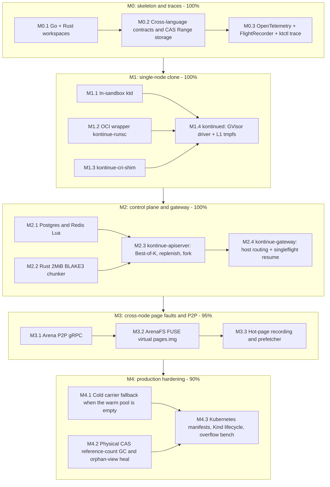

# Kontinue phased plan and progress ledger

> This is the executable plan and the progress ledger. It matches the code. Read it with [ARCHITECTURE.md](./ARCHITECTURE.md) and [DEVELOPMENT_STANDARDS.md](./DEVELOPMENT_STANDARDS.md).

---

## 0. Current progress

| Milestone | Done | Summary | Verified | Still open |
| :--- | :---: | :--- | :--- | :--- |
| **M0: Base, protocol, and traces** | **100%** | Complete | Go (`-race`) and Rust workspace tests pass. `ktctl trace` aggregates a cross-language waterfall. | None |
| **M1: Single-node snapshot and fast clone** | **100%** | Closed | Kind + gVisor clone **23.7ms–48ms**. User processes are uid 1000. `/v1/pty` is a WebSocket terminal. | Egress allowlist is deferred |
| **M2: Control plane and auto-resume** | **100%** | Complete | Postgres advisory leader lock and `kt:inflight` idle exemption verified on Kind. | None |
| **M3: Cross-node ArenaFS, P2P, prefetch** | **95%** | Independent MinIO. The view stays until sandbox release. | 1GB of random data. SHA-256 before and after restore is `2bd667fa429401ad3eba5c13e372b44aba3f7ac5c1ad7ee423d0d7cf8c0e9121`. 515/515 chunks landed on the destination. | First-instruction time is still above the 400ms target |
| **M4: Fallback, GC, and benchmarks** | **90%** | Cold fallback, physical GC, and self-heal are in | Incompatible hardware is rejected. There is no filesystem-only restore. | Multi-tenant nftables and GPU remain deferred |

---

## 1. Milestone dependencies

---

## 2. What each phase actually shipped

### M0: Foundation, contracts, and traces (100%)

- [x] **M0.1 Workspaces and build.** `go.mod`, `Cargo.toml`, `Makefile`, `.dockerignore`, `.cursor/rules/*.mdc`, and `docs/DEVELOPMENT_STANDARDS.md`.
- [x] **M0.2 Shared protocol.** `pkg/protocol` (`constants.go`, `manifest.go`, `ktd.go`, `rpc.go`) and a JSON-compatible Rust crate at `crates/kt-protocol`, including Go's base64 `[]byte` encoding.
- [x] **M0.3 Content-addressed storage.** `LocalFSBackend` and `HTTPObjectStoreBackend` with `Range: bytes=start-end`. Covered by `pkg/storage/cas_test.go`.
- [x] **M0.4 Tracing.** W3C `traceparent` on HTTP, gRPC, and child-process env. Responses set `X-Trace-ID`. Go and Rust ring-buffer `FlightRecorder` at `/debug/traces`. `ktctl trace` aggregates the waterfall.

### M1: Single-node snapshot and Carrier clone (100%)

- [x] **M1.1 `ktd`.** Static Linux binary around 1.0MB, no GC thread. `/internal/freeze` gates new processes, calls `sync()`, and freezes the cgroup. `/internal/init` supports `Expect: 100-continue`, fences `ExecutionID`, rotates the bootstrap token to an access token, injects env, mixes `/dev/urandom`, and rewrites `machine-id`. `/v1/process/exec` runs foreground and background processes. The PID-1 `waitpid(-1)` `ECHILD` race under 240 concurrent execs is fixed. `/v1/files` reads and writes files.
  - [x] Freeze finds external TCP sockets from `/proc/net/tcp` inodes, duplicates them with `pidfd_getfd`, and calls `shutdown`. gVisor returns `EPROTONOSUPPORT` for netlink `SOCK_DIAG` and `ENXIO` for a direct open of `/proc/pid/fd`. The sandbox process needs `CAP_SYS_PTRACE` for `pidfd_getfd`. That capability is dropped before the user process runs.
  - [x] `/v1/pty` is `GET` plus `Upgrade: websocket`, then `openpty`. Frames carry terminal bytes. A Kind check through the gateway received `pty-ok`.
- [x] **M1.2 `kontinue-runsc`.** Injects `--platform=systrap --overlay2=root:self --network=host` so a restored sandbox takes the Carrier Pod CNI netns and its IP. `create` strips `dev.gvisor.*` and `kontinue.sh/*` annotations so `validateRestoreSpec` passes. Restore is rewritten to `--background=true --direct-io=off`. A detached `runsc wait --restore` reports completion. That callback does not unmount the ArenaFS view.
- [x] **M1.3 `kontinue-cri-shim`.** A host systemd daemon. It proxies ordinary CRI, forwards Kubelet `CheckpointContainer` to `kontinued`, and keeps the placeholder-to-active container map so Kubelet PLEG does not kill the sandbox on swap.
- [x] **M1.4 `kontinued`.** `GVisorSandboxDriver` caches a read-only base rootfs with `ctr images mount` and uses separate file handles so `runsc-sandbox` does not inherit a blocking pipe. `CarrierPodWatcher` discovers ready Carrier Pods and their CNI netns. L1 is a tmpfs hardlink pool.
- [x] **Measured.** Kind v1.37.0 and gVisor `release-20261116.0`: 1-to-N clone **23.7ms–48ms**, under the 200ms target.

### M2: Database control plane, incremental suspend, and the gateway (100%)

- [x] **M2.1 Stores.** Postgres via `pgxpool` for templates, snapshots, and sandboxes. Redis Lua for idle-slot `SPOP` plus `kt:carrier:used:*`, monotonic `ExecutionID` fencing on `kt:route:{id}`, and a transition lock. The memory store implements the same operations. `MetadataStore.TryLeader` uses `pg_try_advisory_lock` so only one replenisher and one evictor run.
- [x] **M2.2 Chunker.** `kontinue-arena-helper` streams 2MiB chunks, skips aligned zero pages, hashes with SIMD BLAKE3, and reuses parent hashes. Go `arena.Manager` can fall back to the same diff and upload.
- [x] **M2.3 API server.** Lifecycle REST with `Idempotency-Key`. Best-of-K placement by memory headroom and hardware fingerprint, with jitter so equal nodes do not herd. Kubelet HTTPS client for the v1.30–v1.37 checkpoint API. Online fork. An 8-worker reaper for tainted pods and an idle sweeper. The gateway records in-flight connections in `kt:inflight:{id}`. The sweeper skips suspend while `Inflight > 0`.
- [x] **M2.4 Gateway.** `<port>-<sandbox-id>.<domain>` and `X-Kontinue-Sandbox-ID` routing. `/internal/*` returns 404. `singleflight.Group` collapses concurrent resumes. A suspended in-memory Python server was resumed through this path.

### M3: Cross-node ArenaFS, P2P, and hot-page prefetch (95%)

- [x] **M3.1 P2P.** `NodeArenaP2PService` serves `GetManifest`, `GetChunk`, and `StreamChunks`. A restoring node tries the origin node's memory or NVMe, then remote CAS. Covered by `internal/node/arena/arena_test.go`.
- [x] **M3.2 ArenaFS.** `go-fuse/v2` exposes a read-only virtual `pages.img`. A bitmap and `singleflight` fetch missing 2MiB chunks. `wait --restore` does not unmount the view. The view stays until `ReleaseSlot`, so a later guest read can still fault a page in.
  - [x] On Kind, `CAS_HTTP_URL` points at a dedicated MinIO. After local chunk files were deleted and the origin node was removed, a 1GB random buffer restored with the same SHA-256, `2bd667fa429401ad3eba5c13e372b44aba3f7ac5c1ad7ee423d0d7cf8c0e9121`. All 515 chunks were on the destination node. The resume API returned in 0.40s.
- [x] **M3.3 Hot pages.** `StartHotPagePrefetcher` and `RecordedHotPages` exist. `HotPageIndices` is the order of real `pages.img` reads, recorded when the L3 view is released. An earlier Kind trace started `0, 1, 2, 3, 4, 26, 14, 16`.

### M4: Fallback, GC, and the cluster bundle (90%)

- [x] **M4.1 Cold carrier fallback.** When Redis has no idle slot, the API binds a new Carrier Pod to a node and retries hydrate up to three times. `hack/benchmark_overflow.py` passed 100 concurrent creates against 12 warm slots (8.3x overflow) and 240 concurrent resumes with zero errors. Cold allocate can create pods in parallel, `ResyncIdleCarriers` syncs the watcher immediately, the watcher polls at 100ms, and the carrier image is `kontinue-carrier` pause instead of `sleep`.
- [x] **M4.2 GC and heal.** After Postgres metadata is deleted, `RunEvictionAndGCSweep` builds the live BLAKE3 set from remaining manifests and deletes unreferenced CAS objects. On startup, `HealOrphans` unmounts ArenaFS view directories that are not in the in-memory table and force-deletes stale runsc state under `/run/kontinue/runsc`.
- [x] **M4.3 Manifests and benches.** `deploy/00` through `deploy/05`, `hack/deploy-kind.sh`, `hack/e2e-kind-test.sh`, `examples/demo_lifecycle.py`, and `hack/benchmark_overflow.py` (`overflow`, `warm-only`, `sustained-qps`, plus a JSON report with QPS, span rollup, and carrier RSS).
- [ ] **After M4.** Per-sandbox nftables allowlists on the Carrier netns. GPU `cuda-checkpoint`.

---

## 3. Defects, unfinished code, and the next route (2026-11-20)

Working path: template bake, memory clone, exec, files, suspend, resume, fork, gateway singleflight resume, and traces. A warm-pool create is about 90ms. User code runs as uid 1000.

### 3.1 Confirmed defects

| Defect | Evidence | Status |
| :--- | :--- | :--- |
| Create after the warm pool is empty takes about 1.3–3.5s | Kind overflow bench. Time is in Kubelet and CNI. | Known limit. Not scheduled. |
| A sandbox can reach the node Kubernetes API | A live connection to `192.168.97.4:6443` | Deferred until network isolation |
| Old templates break after a spec change | OCI args or capability changes fail `validateRestoreSpec` | Rebake templates after a spec change |

### 3.2 Unfinished code

- `AllowFilesystemOnlyFallback` is still on the API. Placement no longer uses a disk-only restore.
- Nothing checks that the Carrier image is already on the node before create.
- Cold slots still enter the pool by polling, not by a CRI ready event.
- The 1GB random-buffer digest matches before and after restore, and all 515 chunks landed on the destination. The view unmounts when the sandbox is released, and that close deletes the view directory and the staging directory. A `kontinued` restart unmounts views that are no longer in its memory table. On Kind, delete and process restart left no matching directories.

Out of scope: heterogeneous filesystem-only restore, `hostNetwork` Carriers, and GPU snapshots. The network allowlist waits.

### 3.3 Route, verified on Kind on 2026-11-20

1. **Real resources.** Create accepts `cpuMillis` and `memoryBytes`. After `runsc` starts, the host cgroup v2 directory `/sys/fs/cgroup/kontinue/<container>/` gets `cpu.max` and `memory.max`. Those values are not in the OCI spec and do not change the Carrier Pod. Placement rejects a request that would pass 80% of node memory or `nproc`. A 64MiB and 200 millicpu sandbox wrote `memory.max=67108864` and `cpu.max=20000 100000`. A 1TB request was rejected.
2. **No fake root inside the sandbox.** Before `exec`, the user process drops `DAC_OVERRIDE`, `KILL`, `NET_RAW`, `SYS_CHROOT`, and `MKNOD`. Seccomp rejects `unshare` and `clone` when the flags include `CLONE_NEWUSER`. If the kernel accepts seccomp user notifications, `ktd` also checks `clone3` flags. On Kind, `unshare --user` returns `Operation not permitted`. `CapBnd=0000000020000419` (`CHOWN`, `FOWNER`, `FSETID`, `NET_BIND_SERVICE`, `AUDIT_WRITE`). `/etc/shadow` is unreadable. Python threads still start.
3. **Interactive terminal.** `GET /v1/pty` completes the WebSocket handshake and calls `openpty`. The gateway forwards the upgrade. Kind returned `101` and the command output `pty-ok`.
4. **Cross-node restore.** `CAS_HTTP_URL` points at in-cluster MinIO. The ArenaFS view stays mounted after `runsc wait --restore` and is released with the sandbox, so a later read can still fetch a page from MinIO. A 1GB random buffer was checksummed, local chunks were deleted, and the origin node was taken offline. The same process hashed the buffer again and got `2bd667fa429401ad3eba5c13e372b44aba3f7ac5c1ad7ee423d0d7cf8c0e9121`. All 515 chunks were on the destination. The resume API returned in 0.40s.
5. **Network isolation.** An egress allowlist on the Carrier netns. Not started.
6. **Cold start.** Only if an empty warm pool becomes a real complaint. The lever is a pre-warmed sandbox pool, not more Kubelet tuning.

## 4. Kubelet sandbox cold path (not scheduled)

Cold create is `API Create → kubelet sync → RunPodSandbox → CNI ADD → pause → watcher inserts Redis`. On Kind the time is kubelet sync and `RunPodSandbox`, not the pause process. Config tweaks usually save 10–30%. A step change needs a pre-warmed sandbox or a path that skips `RunPodSandbox`.

| Priority | Item | Status |
| :--- | :--- | :--- |
| Short | Disable Carrier `AutomountServiceAccountToken` | Done |
| Short | Refuse a cold image pull when the Carrier image is not on the node | Open |
| Short | Admit slots from CRI ready events instead of a 100ms poll | Open |
| Short | Cap in-flight cold creates per node | Partial (`createSem=8`) |
| Medium | A local pool of pre-warmed PodSandboxes, so cold create claims one | Open |
| Medium | Raise the idle watermark from recent create QPS | Open |
| Long | A netns pool that is not created by Kubelet, with a dedicated checkpoint entry | Open |
| No | `hostNetwork` Carriers. That breaks one sandbox per netns. | Rejected |

Cilium did not meaningfully change cold-create p50 (about 1.5s). It did improve cold wake (p50 about 680ms).
