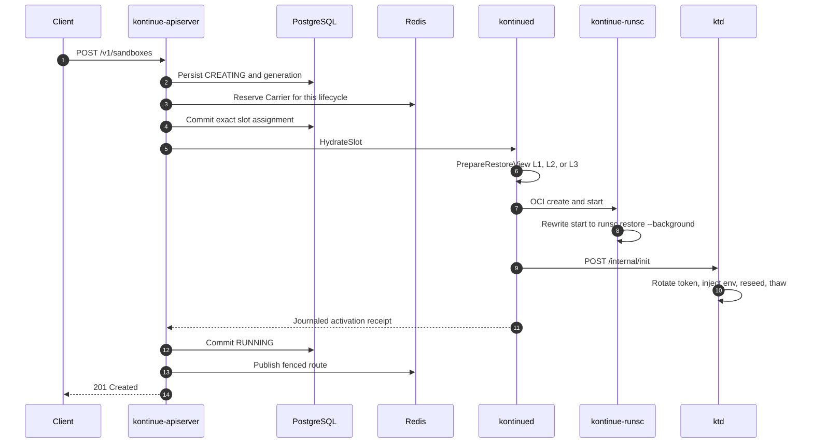

# From a golden template to a sandbox

> See [ARCHITECTURE.md](./ARCHITECTURE.md) for components, [PLAN.md](./PLAN.md) for progress, and [DEVELOPMENT_STANDARDS.md](./DEVELOPMENT_STANDARDS.md) for language rules.
> APIs: `POST /v1/templates` bakes a template. `POST /v1/sandboxes` clones it.
> Code: the template builder in `internal/apiserver/template.go`, `CreateSandbox` in `internal/apiserver/server.go`, `HydrateSlot` in `internal/node/hydrator/service.go`, `PrepareRestoreView` in `internal/node/arena/manager.go`, plus `crates/kontinue-runsc` and `crates/ktd`.

---

## 1. What a template is

A Kontinue template is not a container image. It is an uncompressed split gVisor snapshot of a process tree that has already been warmed.

With a warm Carrier available, creation reuses its existing Pod and network. It maps a memory view, restores gVisor in the background and runs held init inside `ktd`. When the pool is empty, the API creates a Carrier Pod and waits for its registration.

---

## 2. Sequence



---

## 3. What the bake stores

`POST /v1/templates` cold-starts a builder sandbox, runs `warmupScript`, then:

1. `ktd` freezes the workload cgroup.
2. The API calls Kubelet `POST :10250/checkpoint/{ns}/{pod}/{container}`.
3. `kontinue-cri-shim` forwards that to `kontinued`, which runs `runsc checkpoint --compression=none`.
4. The arena helper, or the Go fallback, drops zero 2MiB chunks and hashes the rest with BLAKE3.

| Artifact | Typical size | Contents |
| :--- | :--- | :--- |
| `checkpoint.img` | A few MB | gVisor kernel state, process tree, registers, open fds |
| `pages_meta.img` | Small | Page index |
| `pages.img` | Hundreds of MB to several GB | Memory pages, stored as 2MiB CAS chunks |

`SnapshotManifest` records chunk hashes, zero-page marks, `CompatibilityFingerprint`, the bootstrap token, and optional hot-page order.

`pinInL1Tmpfs` also pins the golden snapshot in each worker's tmpfs so later same-node clones are hardlinks.

Tenant secrets such as `OPENAI_API_KEY` are not in `pages.img`. `POST /internal/init` injects them after restore.

---

## 4. Four steps from template to instance

### 4.1 Claim a slot

`CarrierPoolReplenisher` keeps light Carrier Pods on sandbox nodes. Each pod already has a Kubelet `podUID`, a CNI `eth0`, a Pod IP, and a `NetNSPath`. `CarrierPodWatcher` inserts ready pods into `kt:pool:idle:{node}:{tier}`.

`CreateSandbox` loads the golden snapshot, allocates a sandbox id, sets `ExecutionID` to 1, and mints an access token. `SelectAndClaimSlot` then:

| Check | Behavior |
| :--- | :--- |
| Hardware | Reject a node whose CPU or `runsc` fingerprint does not match the snapshot |
| Locality | Origin node with an L2 hit ranks above an L1 tmpfs node, which ranks above free memory |
| Claim | Redis Lua `SPOP` |
| Empty pool | Bind a new Carrier Pod with `pod.Spec.NodeName`, skipping the scheduler |

The API calls `HydrateSlot` with the slot, snapshot, tokens, and env.

### 4.2 Build the restore view

Each execution owns a separate restore-view directory recorded in its node journal.

**L1 tmpfs.** If the template is pinned, `os.Link` hardlinks `checkpoint.img`, `pages_meta.img`, and `pages.img`. The view lives under `.views` on the same tmpfs as the immutable pin. A failed hardlink attempt falls through to the disk or lazy restore path. Hardlinked clones share the read-only pages. Writes happen in the instance address space.

**L2 NVMe.** If every non-zero chunk is already in the local CAS, the view is materialized on disk. Resume on the origin node does not use the network.

**L3 ArenaFS.** Only the small checkpoint and page-meta files are required to start. `pages.img` is a `go-fuse/v2` file. A fault goes local CAS, then origin P2P, then S3/MinIO HTTP Range. Zero chunks are skipped. The prefetcher walks known hot pages first.

The FUSE view stays mounted after `runsc wait --restore`. It is removed when the sandbox is released, so a page the guest touches later can still be fetched.

### 4.3 Attach the Carrier netns and restore

`GVisorSandboxDriver` writes an OCI `config.json`:

1. The network namespace is `Slot.NetNSPath`, so the sandbox keeps that Carrier's `eth0` and Pod IP.
2. Hostname, args, and env match the checkpoint. `validateRestoreSpec` rejects a drift. Sandbox id, access token, and env are applied later by held init.
3. The annotation `dev.gvisor.internal.restore.host-image-path` points at the view directory.
4. `kontinue-runsc` injects `--overlay2=root:self` so each clone has a private upper dir, strips control-plane annotations, and rewrites `start` to:

```text
runsc restore --image-path=<viewDir> --background=true --direct-io=off --detach <cid>
```

`--background=true` lets the process run after `checkpoint.img` is read. A background `runsc wait --restore` reports completion and does not unmount FUSE.

`kontinued` tells the CRI shim the new container hash so PLEG stays quiet and a later checkpoint can find the container.

### 4.4 Held init and the fenced route

Immediately after restore the guest is still the template: the cgroup is frozen, the old token and hostname are in memory, and the PRNG matches the snapshot. No tenant secret is present.

`kontinued` sends `POST /internal/init` to `PodIP:49983` with `Expect: 100-continue` and `X-Bootstrap-Token`. `ktd` then:

| Step | Action |
| :--- | :--- |
| 1 | Reject a stale `ExecutionID` with 409 |
| 2 | Replace the template token with the tenant access token and store `envVars` only in process memory |
| 3 | Mix a fresh 256-bit seed, rewrite `/etc/machine-id`, and set the hostname to the sandbox id |
| 4 | Record clock skew against the snapshot |
| 5 | Clear `cgroup.freeze` so the warmed processes continue |

The API commits `RUNNING` in PostgreSQL after the node acknowledges activation. It then publishes a fenced Redis route. The gateway checks the sandbox credential and node ownership before forwarding.

---

## 5. Fork and resume

Fork and resume use the same `HydrateSlot` path. Only the snapshot id and execution id change.

| Call | Snapshot | ExecutionID |
| :--- | :--- | :--- |
| `CreateSandbox` | Golden template | `1` |
| Live fork | A `--leave-running` checkpoint of a running sandbox | Parent generation plus 1, with a distinct child identity |
| Resume | Session snapshot, a 2MiB diff against the parent | Previous value plus 1. Origin L2 is preferred, otherwise L3. |

---

## 6. Code map

| Step | Path |
| :--- | :--- |
| Bake | `internal/apiserver/template.go` |
| Create | `internal/apiserver/server.go` `CreateSandbox` |
| Placement | `internal/apiserver/placement.go` `SelectAndClaimSlot` |
| Replenish | `internal/apiserver/replenisher.go` |
| Hydrate | `internal/node/hydrator/service.go` `HydrateSlot` |
| gVisor driver | `internal/node/hydrator/driver_gvisor.go` |
| Carrier watch | `internal/node/hydrator/watcher.go` |
| Arena tiers | `internal/node/arena/manager.go` `PrepareRestoreView` |
| Page faults | `internal/node/arena/lazy_reader.go` |
| FUSE | `internal/node/arena/arenafs_linux.go` |
| Redis | `internal/store/redis.go` |
| OCI rewrite | `crates/kontinue-runsc/src/main.rs` |
| Init and freeze | `crates/ktd/src/lib.rs` |
| Demo | `examples/demo_lifecycle.py` |

---

## 7. Invariants

1. **Warm-pool activation reuses a Carrier.** Carrier replenishment runs in the background. On release, the API keeps the old assignment until it receives a UID-fenced deletion acknowledgement or confirms the old Pod is gone.
2. **Hardware is a hard filter.** An incompatible CPU or `runsc` version is rejected. There is no filesystem-only restore.
3. **Secrets are injected after restore.** They are not in the template `pages.img`.
4. **`ExecutionID` fences routes, deletes, and `ktd` init.** A stale restore cannot overwrite a newer one.
5. **Shared reads, private writes.** Instances share L1 and L2 pages. Rootfs writes go to `overlay2=root:self`.
6. **The view outlives `wait --restore`.** `--background=true` returns before every page is read. The FUSE view stays until the sandbox is released so those pages are not lost.
